# 双足交替式爬楼机构

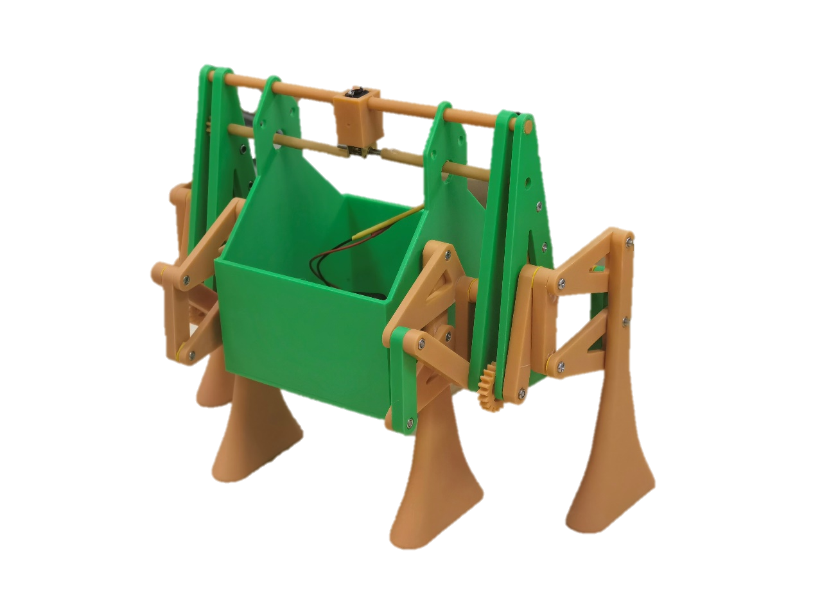

一个面向楼梯环境的机械结构设计与原型验证项目。项目围绕“如何让载物平台跨越连续台阶并保持稳定”展开，从机构方案比较、手绘草图、三维建模和运动仿真，推进到齿轮传动优化、3D 打印零件、实体装配与运动测试。

> 本仓库用于作品集展示，重点呈现设计过程、结构推演和验证结果，不包含完整 CAD 工程文件或生产文件。

## 项目概览

| 项目 | 内容 |
| --- | --- |
| 项目类型 | 机械结构设计与原型验证 |
| 应用场景 | 楼梯环境中的物品搬运与载物平台跨阶 |
| 核心方案 | 双足交替支撑、嵌套式连杆、齿轮传动 |
| 结构组成 | 载物筐、承重杆、机械足、连杆、齿轮组与驱动电机 |
| 验证方式 | 三维运动仿真、有限元分析、3D 打印装配、实体运动测试 |
| 项目成果 | 方案形成实用新型专利授权 |

## 设计目标

楼梯环境同时带来高度变化、落脚空间受限和载物稳定性等问题。项目将稳定载物作为首要目标，尝试以相对紧凑的双足嵌套结构完成支撑、抬升、跨阶和落脚动作，并通过可拆卸载物筐适配不同尺寸的载荷。

设计过程中重点关注：

- 机械足在台阶边缘的接触和落脚位置
- 两侧机构交替动作时的连续支撑
- 连杆、齿轮和承重杆之间的装配空间
- 载物平台在跨阶过程中的姿态变化
- 3D 打印零件的连接孔、公差和装配可行性

## 方案演进

### 1. 机构方案比较

项目初期比较了多种爬楼机构和载物平台形式，围绕落脚方式、结构复杂度、跨阶能力和平台稳定性进行筛选，最终确定双足嵌套式机构作为主要方向。

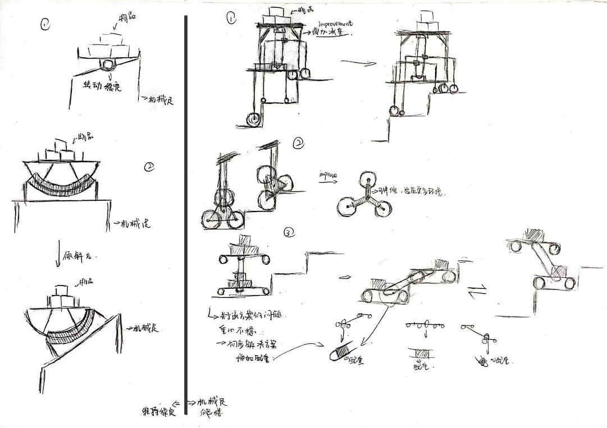

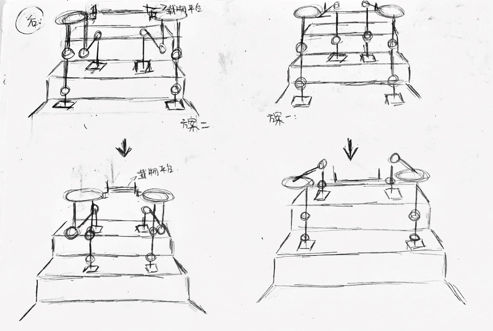

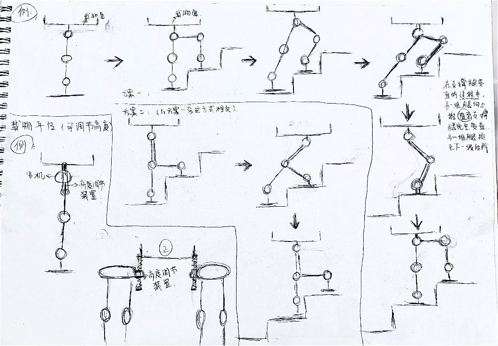

### 2. 三维建模与结构拆分

三维建模阶段将机架、承重杆、机械足、连杆、载物筐和传动件拆分建模，逐步检查连接孔、运动范围和相邻零件的干涉关系。机构采用嵌套式布局，在有限空间内安排多组连杆和机械足，为跨越台阶留出运动空间。

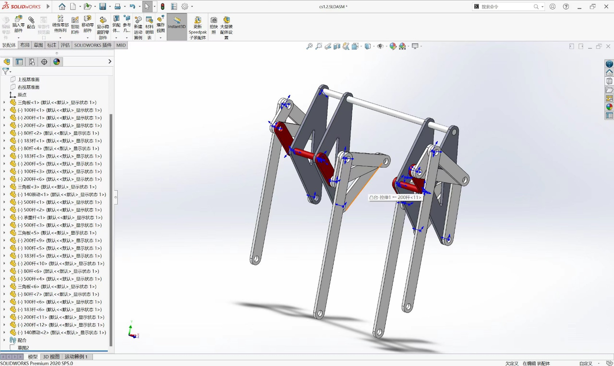

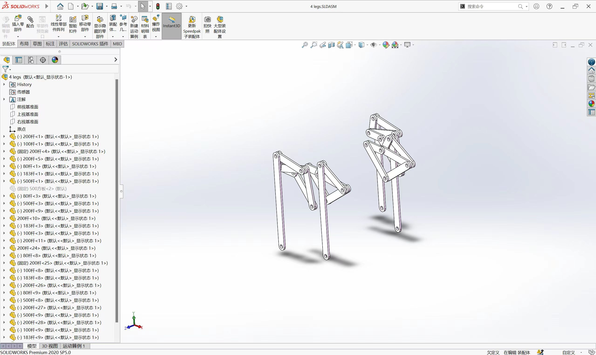

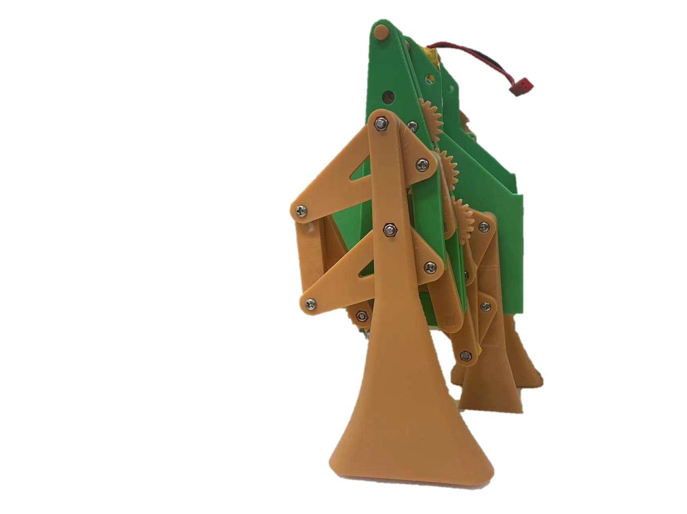

### 3. 传动优化与仿真验证

早期方案使用皮带传动，后续重新设计为齿轮传动，并同步调整腿部形状、载物筐重心和连接结构，以减少机架晃动与零件碰撞。针对关键机械足开展有限元分析，结合运动仿真观察支撑、抬升和跨阶过程。

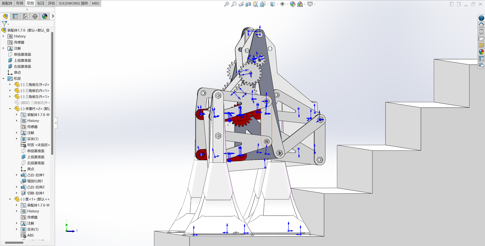

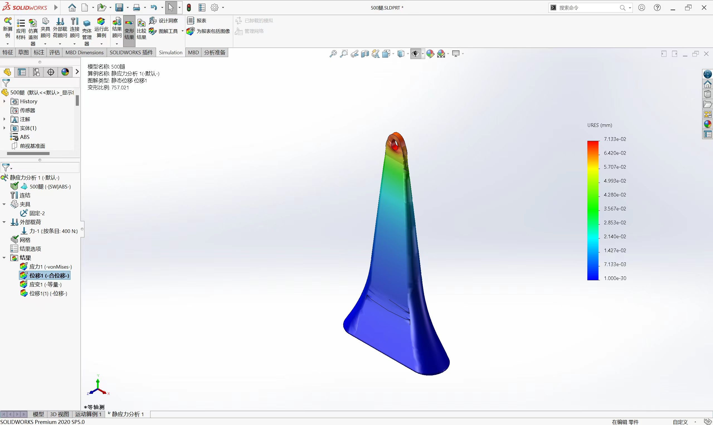

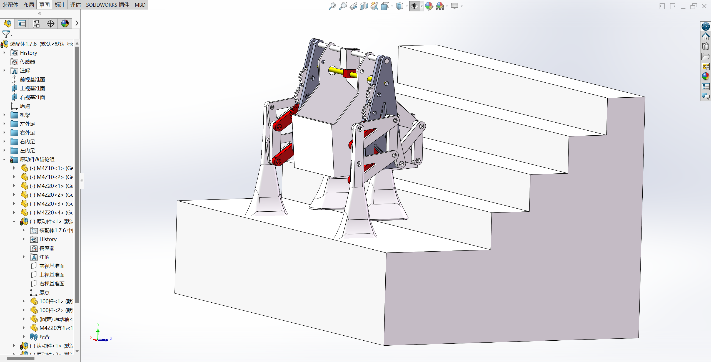

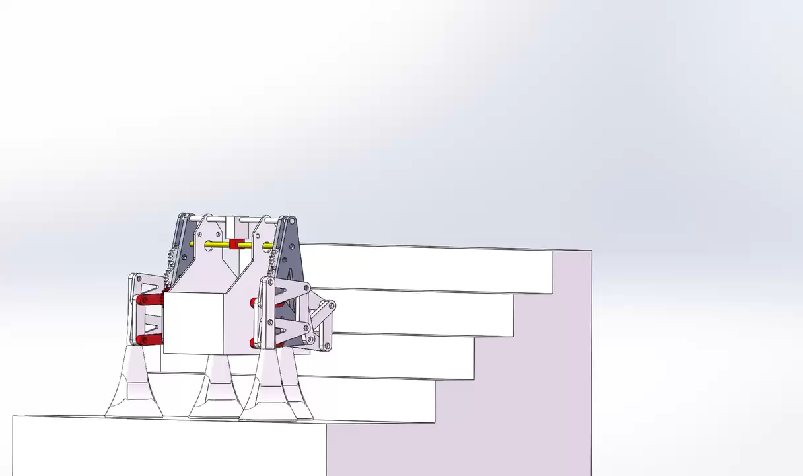

### 4. 3D 打印与实体装配

完成结构定型后，为连接轴和连接孔预留装配公差，制作 3D 打印零件并完成实体装配。样机保留了载物筐、齿轮组、两侧机械足和交替连杆结构，便于继续进行驱动和跨阶测试。

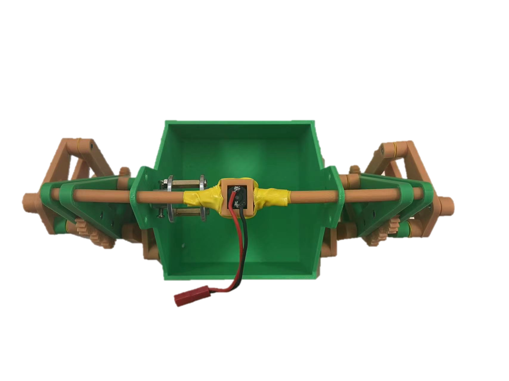

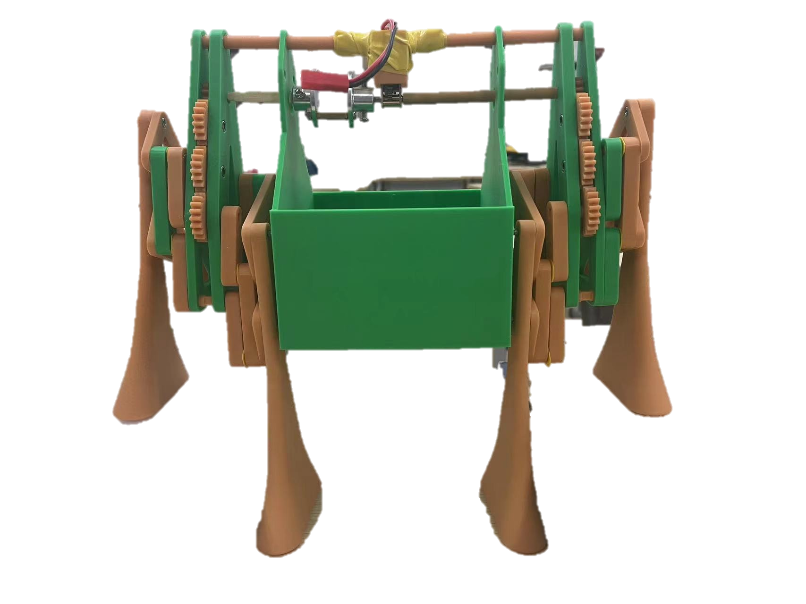

## 机构工作逻辑

1. 驱动电机通过齿轮组输出动力。
2. 两侧连杆带动机械足按交替节奏完成支撑和抬升。
3. 一侧机械足保持支撑时，另一侧抬起并向上跨越台阶。
4. 机械足落到更高一级台阶后，机构交换支撑侧并继续前进。
5. 承重杆连接两侧机构，载物筐位于主体上方，尽量减少跨阶过程中的载荷姿态变化。

## 验证记录

- **概念验证**：通过手绘草图比较不同支撑方式和台阶姿态。
- **结构验证**：在三维装配环境中检查零件干涉、连杆运动范围和传动关系。
- **强度验证**：对关键机械足进行有限元分析，观察受力和位移分布。
- **运动验证**：在楼梯场景中进行跨阶姿态与落脚位置仿真。
- **实体验证**：完成 3D 打印装配，为后续电机驱动和运动测试提供样机基础。

## 视频素材

仓库中的视频来自运动测试与仿真记录。GitHub 页面可直接打开或下载 MP4 文件。

- [斜二侧视角仿真视频](videos/simulation-embedded.mp4)
- [主视角仿真视频](videos/motion-test-05.mp4)
- [全方位仿真视频](videos/motion-test-06.mp4)
- [足部结构概念设计测试片段 01](videos/motion-test-01.mp4)
- [足部结构初期设计测试片段 02](videos/motion-test-02.mp4)

## 项目亮点

- 将双足交替支撑与嵌套式连杆结合，面向楼梯环境探索紧凑型载物机构。
- 从草图、建模、传动优化和仿真推进到 3D 打印样机，形成完整的设计验证链路。
- 通过可拆卸载物筐、齿轮传动和机械足结构提升方案的适配性与可验证性。
- 兼顾机构设计、运动分析、结构优化和实体装配，最终形成实用新型专利授权成果。

## 说明

本仓库仅公开经过筛选的图片和视频素材，用于展示设计思路与验证过程。完整 CAD、仿真工程、专利文件和生产资料未公开。
